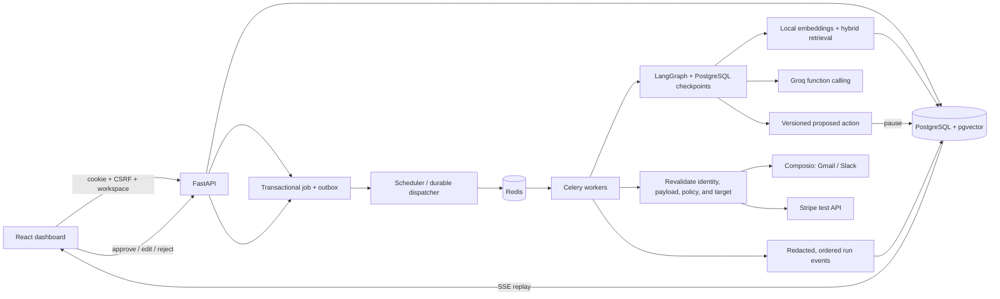

# How SupportPilot works — every file explained

This is the map of the application, from the first browser request to a safely completed provider action. Read [README.md](README.md) for commands and [verification notes](docs/VERIFICATION.md) for test profiles and operating limits. `download.svg` is the original user-provided architectural reference; it has been preserved.

## Repository map

```text
SupportPilot/
├── frontend/                 React application, typed API client, design system, 3D scene, browser tests
│   ├── src/components/       Reusable accessible UI and graphics boundaries
│   ├── src/features/         One module per dashboard screen
│   ├── src/lib/              Generated contracts, networking, state, fixtures, pagination
│   └── e2e/                  Desktop/mobile workflow and accessibility tests
├── backend/
│   ├── app/api/              Authenticated, workspace-scoped HTTP interfaces
│   ├── app/services/         Retrieval, orchestration, approvals, providers, queues, storage
│   ├── app/                  Configuration, persistence, identity, startup, CLI, demo data
│   ├── migrations/           PostgreSQL schema, pgvector indexes, row-level security
│   └── tests/                Security, workflow, recovery, OAuth, retrieval, and provider tests
├── samples/                  Clearly fictional product documentation for demo use
├── scripts/                  API generation, documentation checks, budgets, load tests, operations
├── deploy/                   Local and TLS reverse proxy configurations
├── .github/workflows/       Verification, release image publishing, controlled deployment
└── docs/                    Verification procedures and measured-limit interpretation
```

## The pieces together



```mermaid
sequenceDiagram
  participant U as Workspace owner
  participant API as FastAPI
  participant DB as PostgreSQL
  participant W as Worker + LangGraph
  participant P as Provider
  API->>DB: Commit run, job, and outbox atomically
  W->>DB: Claim leased job and acquire ticket/run lock
  W->>DB: Retrieve authorized current document chunks
  W->>DB: Persist exact proposed action and checkpoint
  W-->>U: Approval pending; worker slot released
  U->>API: Edit creates a new version, then approve that version
  API->>DB: Compare-and-swap decision + resume job
  W->>DB: Resume checkpoint and revalidate current authorization
  W->>DB: Persist dispatch intent and idempotency key
  W->>P: Execute exact approved arguments
  P-->>W: Result or uncertain outcome
  W->>DB: Persist redacted outcome and ordered events
  DB-->>U: Live SSE events / replayable history
```

## Lifecycle walkthroughs

**Sign-in and membership.** `api/auth.py` creates an opaque cookie session; only its hash is stored. Every API database dependency uses function scope so transactions commit before HTTP responses or cookies leave the server; the session-header regression test verifies this ordering. See [FastAPI dependency scope](https://fastapi.tiangolo.com/tutorial/dependencies/dependencies-with-yield/#early-exit-and-scope). `security.py` checks expiration, request origin, CSRF, and selected-workspace membership. Email/password uses Argon2id. Google uses PKCE, state, nonce, verified email, and signed OIDC claims. Existing accounts explicitly link Google while authenticated. One-time invitation/reset tokens are consumed atomically. Owners cannot use reset links to take over accounts shared with unrelated workspaces. The login page only offers methods enabled by the deployment's public availability endpoint.

**OAuth connections.** The browser requests a Connect Link for a fixed allowed toolkit. The server stores a short-lived attempt and an HttpOnly browser cookie. Composio handles provider consent and token custody. The public HTTPS verifier redeems the returned session URI using the authenticated workspace/user identity, then matches the account and toolkit to the original attempt. Connections stay personal; every tool invocation checks their owning identity and configured auth configuration. Automation is disabled until explicit consent to the workspace owner-approval policy.

**Document ingestion and retrieval.** Uploads or explicitly published Drive snapshots are stored under workspace/document/version keys. A durable ingestion job extracts bounded text, tokenizes at 200 tokens with 32-token overlap, embeds locally, and stores normalized vectors in pgvector. Live retrieval fuses authorized vector and full-text candidates and returns up to six passages. Citations identify immutable versions and page/section context. Removing a document disables retrieval and source access; refreshing Drive creates another snapshot. Demo mode intentionally uses a lexical fixture instead of claiming semantic embeddings.

**Tickets and planning.** The scheduler polls an enabled Gmail label every minute, establishes an activation baseline, skips outbound messages, and deduplicates provider IDs. New inbound messages create workspace tickets and idempotent runs. The graph reads authorized context, retrieves evidence, and lets Groq choose only registered, typed functions. Read tools can inspect shared tickets and the explicitly linked test payment. Arbitrary shell execution, tool discovery, recipient changes, and inferred payment identifiers are unavailable.

**Approval and execution.** Proposed outbound actions are durable records, separate from model output and checkpoint state. Editing supersedes the old version. Decisions use a compare-and-swap update; approval expires after 24 hours. The action snapshots its provider account and display label, so reconnecting another mailbox or changing a Stripe test key cannot reuse approval. Resumed workers recheck membership, approver role, connection, payload hash, ticket state, source versions, destination policy, and payment state. A changed target or source returns to planning/retrieval and requires approval of the newly prepared version. Dispatch intent is committed before provider I/O, and the result is stored separately.

**Recovery and progress.** PostgreSQL is the source of truth. Redis delivers jobs at least once; durable claims, leases, per-run/ticket locks, action records, and provider idempotency make replay safe. Individual job attempts retain their ordinal, lease owner, outcome, time, and redacted error even when an owner resets the retry budget. Transient errors back off with jitter, quota errors park, and exhausted jobs remain in dead letters. Repeated worker deaths exhaust the recovery budget; a worker lost during a non-idempotent send immediately requires reconciliation. Unknown Gmail/Slack outcomes require owner reconciliation evidence. Stripe uses the same key and action metadata to find a previously completed refund, with a conservative retry window. Events are redacted before persistence and streamed with sequence IDs; reconnect resumes after the last event. Private model reasoning is not displayed.

**Themes and 3D.** Tokens in `styles.css` define both themes. `ThemeProvider` follows the system unless a user preference is stored. `Constellation` checks visibility, screen size, reduced motion, graphics preference, and WebGL availability before loading `AgentScene`. The scene uses procedural meshes, shared materials, instanced particles, bounded pixel density, and on-demand rendering. It settles at rest and falls back when unavailable or too slow. Feature routes and 3D vendor code are split from initial loading.

## Configuration and commands

All variables are documented without real secret values in `.env.example`. Never commit `.env`, passwords, provider keys, or encrypted-key backups.

| Configuration | Meaning and relationship |
| --- | --- |
| `APP_ENV`, `DEMO_MODE`, `APP_URL` | Production requires live mode, HTTPS, and a strong secret. APP_URL must match browser origin and registered callbacks. |
| `DATABASE_URL` | Least-privilege API connection. Business rows require an active workspace scope. SQLite is demo/test only. |
| `WORKER_DATABASE_URL` | Trusted scheduling/execution role. Owns checkpoints and can process cross-workspace queue metadata. Never send this to the frontend. |
| `MIGRATION_DATABASE_URL` | Administrative schema connection, used only by migrations. |
| `POSTGRES_PASSWORD`, `APP_DB_PASSWORD`, `WORKER_DB_PASSWORD` | Initial Compose role passwords. Keep the corresponding database URLs consistent; changing these variables does not rotate an existing database role automatically. |
| `REDIS_URL` | Celery broker and shared Groq quota reservations. Losing Redis must not lose PostgreSQL job records. |
| `SECRET_KEY`, `ENCRYPTION_KEY` | Deployment secret and Fernet key for workspace Stripe test credentials. Generate fresh values through the CLI; preserve the encryption key when restoring data. |
| `GROQ_API_KEY`, `GROQ_MODEL` | Server-only reasoning configuration. No browser key storage or automatic paid fallback. |
| `GROQ_REQUESTS_PER_MINUTE`, `GROQ_TOKENS_PER_MINUTE` | Shared conservative budgets. Upstream quotas can still return 429 and park work. |
| `COMPOSIO_API_KEY`, `COMPOSIO_*_AUTH_CONFIG` | Project credential and three operator-provisioned least-privilege toolkit configurations. Composio stores users' provider tokens. |
| `GOOGLE_CLIENT_ID`, `GOOGLE_CLIENT_SECRET` | Separate app-login OIDC configuration; not the Gmail/Drive tool connection. |
| `STORAGE_BACKEND`, `STORAGE_PATH` | Local volume implementation by default. Switch to `s3` for multi-host workers. |
| `S3_BUCKET`, `S3_ENDPOINT_URL`, `AWS_*` | S3-compatible object storage and region/credentials. Prefer server workload identities in a hosted deployment. |
| `EMBEDDING_MODEL`, `EMBEDDING_REVISION` | Pinned local CPU model. Changing embedding space requires reindexing documents. Docker persists downloads in its model-cache volume. |
| `WORKSPACE_CONCURRENCY`, `GLOBAL_CONCURRENCY` | Default 2 executing jobs per workspace and 20 globally. Worker process count and provider capacity impose further limits. |
| `DOMAIN`, `TLS_EMAIL` | Caddy certificate configuration for the production Compose override. |
| `GHCR_IMAGE_PREFIX`, `IMAGE_TAG` | Published release image prefix and selected tag. |
| `RUN_LIVE_TESTS`, `RUN_EMBEDDING_TESTS`, `DEMO_E2E_URL`, `POSTGRES_TEST_URL`, `POSTGRES_ADMIN_TEST_URL` | Explicit optional test targets. Never assume fixture success proves a live provider or database configuration. |

Use the README commands to start, build, test, generate API types, back up, and deploy. Regenerate contracts in order: `python scripts/export_openapi.py`, then `npm run generate:api` from `frontend`. Update this guide whenever adding/removing a repository file and run `python scripts/check_file_guide.py`.

## Extension points and troubleshooting

- Add a tool through its Pydantic schema, explicit provider method, workflow registry, server validation, approval classification, and integration tests. Do not expose the internal proxy as a model tool.
- Add a dashboard screen under `frontend/src/features`, use shared UI tokens/components and the typed API client, then add a route and browser coverage.
- Add schema changes as new Alembic revisions after the initial release. Keep RLS policies and app/worker grants aligned with new tenant tables.
- For missing OAuth credentials, configure Connections rather than using another person's account. For expired tokens, reconnect. For quota parks, honor the provider reset; do not hot-loop retries.
- For failed ingestion, inspect the document error and dead-letter record. For changed approval targets, review the replacement. For uncertain sends, inspect the provider before recording reconciliation.
- For an unavailable Docker daemon, use the local demo while fixing Docker independently. Compose validation does not prove its containers are healthy.
- For a static scene, check graphics preference, reduced motion, viewport width, and WebGL support. The fallback is intentional and keeps every workflow available.
- Scale to multiple API/worker hosts through shared PostgreSQL/Redis and S3 storage. Monitor queue age and quota parks before increasing concurrency; preserve durable event history and backup/checkpoint retention policies.

## Individual file inventory

The following entries cover every deliverable file. Installed dependencies, local databases/uploads/models, screenshots, test reports, compiler caches, and build output are generated artifacts and intentionally excluded.

| File | What it does | How it fits with the rest |
| --- | --- | --- |
| `.dockerignore` | Excludes secrets, local dependencies, caches, data, and reports from container build contexts. | Keeps both Docker builds small and prevents accidental credential packaging. |
| `.env.example` | Documents deployment variables using placeholders and local-only defaults. | Compose and backend settings read the corresponding private `.env`. |
| `.github/workflows/ci.yml` | Runs backend, frontend/browser, PostgreSQL/RLS, contract, documentation, and container checks. | Protects the same interfaces exercised locally before releases. |
| `.github/workflows/deploy.yml` | Deploys a selected release through a protected environment and verified SSH host. | Consumes published images and the server's private configuration. |
| `.github/workflows/release.yml` | Builds and publishes tagged backend/frontend images to GHCR. | Supplies the image names/tags selected by production Compose. |
| `.gitignore` | Excludes environment secrets and generated runtime/build/test artifacts. | Defines the boundary between source delivery and local state. |
| `FILE_GUIDE.md` | Explains architecture, lifecycles, configuration, and every deliverable file. | Checked against the actual repository inventory in CI. |
| `README.md` | Provides quickstart, real-integration setup, testing, scaling, deployment, and recovery commands. | Entry point linked to this detailed guide and verification notes. |
| `backend/Dockerfile` | Builds a non-root Python 3.12 image with CPU embedding support. | Shared by API, worker, scheduler, and migration services. |
| `backend/alembic.ini` | Configures the migration location and migration logging. | Used by the migration service and local Alembic commands. |
| `backend/app/__init__.py` | Declares the application package. | Enables package imports and editable installation. |
| `backend/app/api/__init__.py` | Marks the HTTP route package and documents its boundary. | Route modules delegate business logic to services. |
| `backend/app/api/auth.py` | Implements sessions, passwords, invitations, resets, and Google PKCE/OIDC flows. | Uses identity records and security helpers; returns the dashboard session contract. |
| `backend/app/api/connections.py` | Creates Connect Links, verifies callbacks, manages personal connections and automation consent. | Bridges authenticated users to Composio without exposing provider tokens. |
| `backend/app/api/knowledge.py` | Handles uploads, Drive publication, document versions, authorized downloads, refresh/deletion, and search. | Connects storage, ingestion jobs, retrieval, and source citations. |
| `backend/app/api/runs.py` | Exposes tickets, runs, events/SSE, decisions, renewal/reconciliation, recovery, and audit history. | The dashboard's main workflow interface over durable services. |
| `backend/app/api/workspaces.py` | Manages workspace settings, encrypted Stripe test configuration, members, invites, and reset links. | Enforces owner permissions and cross-workspace reset restrictions. |
| `backend/app/cli.py` | Starts the local demo, bootstraps an owner, generates secrets, and provisions checkpoints. | Handles administrative setup outside public onboarding. |
| `backend/app/config.py` | Loads typed environment settings and validates runtime safety requirements. | Shared configuration for all backend processes. |
| `backend/app/db.py` | Builds engines/sessions, applies transaction-local workspace scope, and supports demo schema creation. | Central persistence boundary for APIs and workers. |
| `backend/app/dto.py` | Defines typed public response contracts. | FastAPI exports these contracts for generated TypeScript types. |
| `backend/app/main.py` | Constructs FastAPI, middleware, lifecycle, health/readiness, private metrics, and route registration. | API process entry point; starts only the local SQLite demo dispatcher. |
| `backend/app/models.py` | Defines identity, tenants, connections, documents/versions/chunks, tickets, runs, actions, jobs, and audit tables. | Shared SQLAlchemy schema used by migrations and business services. |
| `backend/app/scheduler.py` | Dispatches durable work, schedules Gmail syncs, and cleans expired session/rate records. | Keeps Redis outages recoverable from PostgreSQL state. |
| `backend/app/schemas.py` | Validates request payloads and the exact allowed outbound-action arguments. | Used by HTTP routes and the function-calling action registry. |
| `backend/app/security.py` | Implements hashes, Argon2, encrypted secrets, redaction, sessions, CSRF, membership, authorization, and throttling. | Security dependencies applied consistently across API modules. |
| `backend/app/seed.py` | Creates a fictional Acme workspace, accounts, documents, tickets, and illustrative history in demo mode. | Feeds the real demo workflow without live credentials. |
| `backend/app/serialization.py` | Serializes safe public fields and implements stable cursor pagination. | Prevents accidental secret-field exposure and unbounded API lists. |
| `backend/app/services/__init__.py` | Declares the business-services package. | Keeps service interfaces separate from HTTP transport. |
| `backend/app/services/approvals.py` | Validates proposals, versions decisions, revalidates targets, and persists dispatch intent/outcomes. | Final server-enforced boundary before sensitive provider actions. |
| `backend/app/services/events.py` | Records ordered, redacted node events and duration/error counters. | Supplies live SSE traces and historical observability. |
| `backend/app/services/jobs.py` | Implements Celery tasks, durable outbox dispatch, leases, concurrency, retry/dead letters, and Gmail ingestion. | Connects PostgreSQL truth, Redis delivery, providers, and the graph. |
| `backend/app/services/knowledge.py` | Extracts bounded text, chunks, embeds, indexes, and performs hybrid retrieval. | Produces authorized passages and version-aware citations for the graph. |
| `backend/app/services/providers.py` | Implements fixed Composio provider methods, Gmail parsing, Stripe test refunds/reconciliation, and Groq quota-controlled calls. | Only provider-facing network layer; credentials never enter model tools. |
| `backend/app/services/storage.py` | Defines local-volume and S3-compatible storage implementations. | Allows API and workers to share immutable document objects across hosts. |
| `backend/app/services/workflow.py` | Defines the bounded LangGraph nodes, typed tool registry, interrupts, checkpoint resume, and result summaries. | Orchestrates retrieval, reasoning, proposal, approval, and execution services. |
| `backend/migrations/env.py` | Loads model metadata and administrative database settings for Alembic. | Applies schema changes independently of API permissions. |
| `backend/migrations/versions/0001_initial.py` | Creates schema, vector/FTS indexes, role grants, and tenant RLS policies. | Establishes database isolation and worker/API privilege boundaries. |
| `backend/migrations/versions/0002_job_attempts.py` | Adds immutable provider-account snapshots, tenant-protected job attempts, and a restricted operational-counts SQL function. | Upgrades existing databases without binding old approvals to newly connected accounts; private metrics work without API worker credentials, and SQLite demo startup applies the same migrations. |
| `backend/openapi.json` | Generated snapshot of the public API contract. | CI detects drift; frontend type generation consumes it. |
| `backend/pyproject.toml` | Declares the Python package, dependencies/extras, lint rules, and test markers. | Used by local installation, Docker, and CI. |
| `backend/requirements.lock` | Records resolved dependency versions from the validated core environment. | Supports repeatable CI installation; the embedding extra is explicitly installed when required. |
| `backend/tests/conftest.py` | Builds isolated users, workspaces, SQLite databases, clients, and durable test checkpointers. | Shared fixture layer for deterministic integration tests. |
| `backend/tests/test_knowledge.py` | Tests upload, indexing, tenant-filtered search, deletion, chunk bounds, and malformed inputs. | Verifies document lifecycles through the API and jobs. |
| `backend/tests/test_live.py` | Provides explicitly enabled read-only Groq access and real semantic embedding smoke tests. | Distinguishes actual provider/model verification from demo fixtures. |
| `backend/tests/test_oauth.py` | Verifies Google PKCE/state/nonce/signatures, callback browser binding, and invalid-edit safety. | Exercises authentication and approval boundary failure modes. |
| `backend/tests/test_postgres.py` | Tests migrated PostgreSQL RLS, checkpoint/role privilege denial, and real MiniLM embedding/index/search/deletion through pgvector. | Runs with real database URLs supplied by CI or an operator; semantic evaluation explicitly requires the embeddings extra. |
| `backend/tests/test_recovery.py` | Covers broker loss, leases, retries, quota parks, uncertain sends, payload tampering, and provider identity/idempotency. | Verifies failure behavior rather than only happy paths. |
| `backend/tests/test_security.py` | Tests login throttling, CSRF/origin, tenant access, roles, secrets, tokens, and revocation gates. | Protects identity and isolation contracts. |
| `backend/tests/test_workflow.py` | Runs real graph/checkpoint approval, edit/resume, rejection, stale-target, and replay scenarios. | Verifies orchestration and the one-action dispatch boundary. |
| `backend/tests/test_end_to_end.py` | Exercises live-mode Groq function calling, Composio Gmail/Slack/Drive, Stripe test adapters, edited approvals, immutable sources, bounded tool loops, and rejected injection attempts through deterministic HTTP fixtures. | Keeps orchestration and provider serialization real; synthetic embedding vectors and HTTP responses avoid external actions in CI. |
| `backend/tests/test_distributed.py` | Runs an opt-in real PostgreSQL/pgvector, Redis/Celery, and PostgreSQL checkpoint upload → draft → edit → approval → execution journey. | Uses separate API/worker roles, unique broker queues, and cleanup restricted to fixture IDs; CI provisions the required services. |
| `compose.production.yaml` | Overrides public ports, TLS proxy, and production/live safety settings. | Layers on the base Compose deployment without exposing databases. |
| `compose.yaml` | Defines PostgreSQL, Redis, migrations, API, workers, scheduler, frontend, and persistent volumes. | Complete local/distributed pilot topology. |
| `deploy/Caddyfile` | Serves the local SPA and proxies API/SSE with body limits and headers. | Connects the frontend container to the private API. |
| `deploy/Caddyfile.production` | Adds automatic TLS, strict headers/CSP, and production reverse proxy routing. | Uses domain/email settings and persistent certificate volumes. |
| `docs/VERIFICATION.md` | Documents test modes, limits, performance measurement, load testing, and operational requirements. | Prevents fixture results from being mistaken for live deployment evidence. |
| `download.svg` | Original architecture supplied by the user. | Preserved reference for dashboard → orchestrator → tools/RAG → approval → execution. |
| `frontend/Dockerfile` | Builds the typed React application and serves it from a non-root Caddy image. | Produces the public-facing release artifact. |
| `frontend/e2e/live-demo.spec.ts` | Opt-in browser test of real demo login and asynchronous agent response. | Connects the UI to the running API without external provider actions. |
| `frontend/e2e/workflow.spec.ts` | Drives real upload/indexing, cited Gmail draft editing, Slack escalation, test-payment linking/refund, duplicate approval rejection, SSE replay, invitations, role restrictions, and password login. | Connects production frontend pages to the persisted fixture API; external provider consent remains credential-gated. |
| `frontend/e2e/preview.spec.ts` | Tests themes, mobile layout, approval editing, chat/search, traces, reduced motion, accessibility, and WebGL. | Captures user-visible frontend evidence and regression failures. |
| `frontend/index.html` | Provides page metadata, favicon, React root, and early theme application. | Avoids a flash of the wrong theme before React mounts. |
| `frontend/package-lock.json` | Locks npm dependency resolution and integrity metadata. | Used by reproducible `npm ci` builds. |
| `frontend/package.json` | Declares UI/build/test tools and development/generation commands. | Frontend build and verification entry points. |
| `frontend/playwright.config.ts` | Configures desktop/mobile projects, production preview server, traces, and test-browser software WebGL. | Makes browser coverage reproducible without requiring a physical GPU. |
| `frontend/public/favicon.svg` | Code-native SupportPilot navigation-mark favicon. | Branding for browser tabs without an external asset dependency. |
| `frontend/src/App.tsx` | Wires sessions, workspace switching, shell navigation, preview mode, collections, mutations, search, and notifications. | Integrates isolated feature modules through workspace context. |
| `frontend/src/components/AgentScene.tsx` | Renders the procedural 3D agent core, orbital geometry, lighting, instanced particles, and pointer easing. | Loaded only through the graphics boundary; pauses at rest/inactive tabs. |
| `frontend/src/components/Constellation.tsx` | Controls lazy graphics loading, compatibility/visibility checks, fallbacks, and service labels. | Keeps every page usable when WebGL or motion is unavailable. |
| `frontend/src/components/ThemeProvider.tsx` | Resolves system/light/dark preferences and persists the selected theme. | Supplies consistent colors to both DOM and 3D components. |
| `frontend/src/components/ui.tsx` | Defines shared buttons, badges, avatars, provider marks, dialogs, citations, empty/loading states, and timestamps. | Accessible reusable primitives used by every screen. |
| `frontend/src/features/ApprovalsPage.tsx` | Presents exact action details, citations, approval/rejection/edit, expiry renewal, and provider reconciliation. | Human-control interface over versioned action APIs. |
| `frontend/src/features/ChatPage.tsx` | Provides guided prompts, asynchronous agent conversations, result polling, and source display. | Creates durable runs rather than performing actions directly. |
| `frontend/src/features/ConnectionsPage.tsx` | Shows personal integration health, OAuth entry points, disconnect, and automation consent. | Keeps provider access setup explicit and user-specific. |
| `frontend/src/features/InboxPage.tsx` | Implements a virtualized ticket list, conversation view, filtering, and draft-run creation. | Binds support tickets to the correct acting-account workflow. |
| `frontend/src/features/KnowledgePage.tsx` | Handles uploads, retrieval, source states, Drive publication consent, refresh, and deletion. | Makes the real knowledge pipeline usable from the dashboard. |
| `frontend/src/features/Login.tsx` | Implements password/demo/Google entry and invite/reset forms with 3D branding. | Connects authentication routes to the workspace shell. |
| `frontend/src/features/Overview.tsx` | Composes the hero, agent constellation, metrics, activity, connections, approvals, and recent tickets. | A navigable summary of current workspace data; sample totals are preview-only. |
| `frontend/src/features/RunsPage.tsx` | Shows execution history, SSE-replayed node traces, results, citations, and recoverable retries. | Explains the progress and outcome of each durable run. |
| `frontend/src/features/SettingsPage.tsx` | Edits workspace/channel settings, graphics preference, Google linking, invites, and Stripe test credentials. | Owner and personal configuration surface backed by server permission checks. |
| `frontend/src/features/shared.tsx` | Defines feature headings, shared error feedback, and pagination controls. | Keeps common page behavior consistent without coupling features. |
| `frontend/src/lib/api.generated.ts` | Generated TypeScript interfaces for OpenAPI paths and Pydantic contracts. | Compile-time backend/frontend contract agreement; do not hand-edit. |
| `frontend/src/lib/api.ts` | Implements authenticated fetch, CSRF/workspace headers, errors, idempotent posts, source URLs, and SSE URLs. | Central networking boundary for all features. |
| `frontend/src/lib/fixtures.ts` | Contains clearly illustrative browser-preview users, tickets, runs, documents, actions, and traces. | Allows design exploration without connecting to a backend or provider. |
| `frontend/src/lib/types.ts` | Aliases generated response contracts and small UI-only type adaptations. | Keeps UI data shapes derived from the real API. |
| `frontend/src/lib/useCollection.ts` | Implements cursor-based infinite queries and flattened collections. | Supports older history without fetching unbounded lists. |
| `frontend/src/lib/workspace.tsx` | Declares typed workspace context and mutation/pagination interfaces. | Features share explicit state contracts rather than accessing app internals. |
| `frontend/src/main.tsx` | Mounts React, query cache, router, themes, fonts, and global styles. | Browser application entry point. |
| `frontend/src/styles.css` | Defines light/dark design tokens, layouts, typography, animation, responsive rules, and reduced-motion behavior. | Shared visual system for the whole dashboard. |
| `frontend/tsconfig.app.json` | Enables strict application type checking and unused-code checks. | Validates React feature and generated-contract consumers. |
| `frontend/tsconfig.json` | References the application and tooling TypeScript projects. | Runs both checks through the frontend build command. |
| `frontend/tsconfig.node.json` | Types Vite and Playwright configuration in the Node environment. | Separates browser and tooling compilation requirements. |
| `frontend/vite.config.ts` | Configures React/Tailwind, API proxy, production manifest, and explicit lazy 3D chunks. | Supports local full-stack development and enforceable loading budgets. |
| `samples/billing-policy.md` | Fictional seat-proration/refund documentation with test-mode boundaries. | Seeded as searchable demo evidence. |
| `samples/getting-started.md` | Fictional workspace onboarding and thoughtful support workflow guide. | Helps demonstrate cited retrieval and document ingestion. |
| `samples/product-handbook.md` | Fictional invitation, password, export, and rate-limit support instructions. | Grounds the seeded customer-ticket examples. |
| `scripts/backup.sh` | Exports PostgreSQL and upload backups without embedding credentials in the script. | Supports the documented restore procedure and separate secret backup. |
| `scripts/audit_frontend.mjs` | Starts a production preview and temporary Chromium profile, runs Lighthouse, and saves a measured report. | Checks the mobile performance/LCP/CLS targets without relying on an existing user browser session. |
| `scripts/check_bundle.mjs` | Measures gzip size across Vite entry/static imports and rejects eager 3D code. | Enforces the initial JavaScript budget in CI. |
| `scripts/check_file_guide.py` | Compares this table with actual deliverable files and detects missing/stale entries. | Keeps the requested per-file documentation complete. |
| `scripts/export_openapi.py` | Exports the FastAPI contract without starting workers or calling providers. | First step of TypeScript API generation and CI drift checks. |
| `scripts/init-db.sh` | Creates distinct non-superuser API and worker database roles with separate passwords. | Establishes the privilege boundary before Alembic grants tenant-table access. |
| `scripts/load_test.py` | Creates isolated demo fixtures and drives a 100-user, 20-client workload with hardware-labelled reporting. | Measures request/workflow behavior without implying real-provider throughput. |
| `scripts/start-demo.ps1` | Installs local dependencies and prints Windows commands for the backend/frontend demo. | Convenience setup for the user's development environment. |
